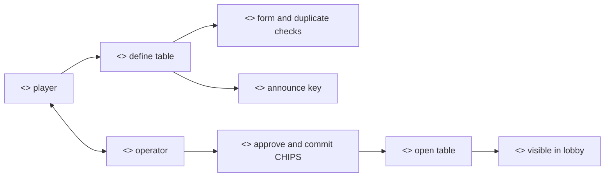
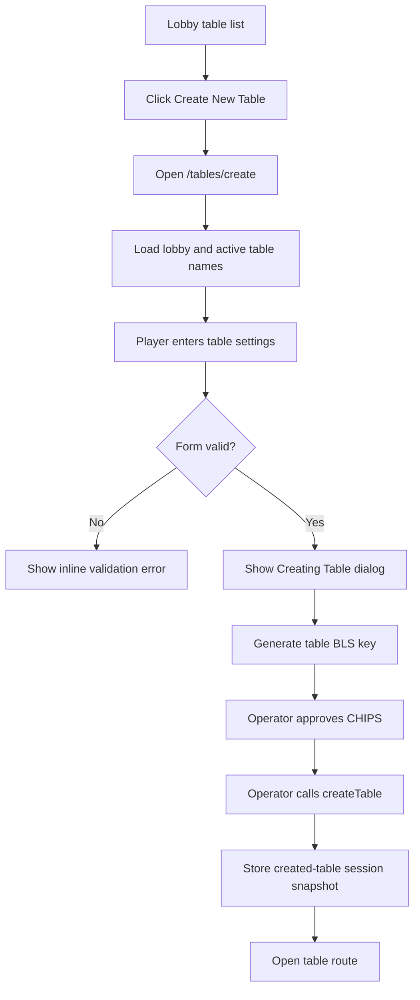

# Create Table Flow

## Purpose

The Create Table flow lets a subscribed player create a new poker table, generate the table BLS announce key, approve CHIPS for the lobby, and seat the creator as the first player.

## Actors

- Player: chooses table settings and authorizes deterministic table keys.
- Player operator: approves CHIPS and submits the table-creation transaction.
- PrivatePoker lobby contract: creates the table and stores the first `TablePlayer`.
- CHIPS contract: checks balance and approves the lobby for the buy-in.

## Rationale

Creating a table is the first moment where the player initiates a value-bearing poker session. The goal is to show how player funds move from a verified, subscribed account into a transparent table escrow path, and to identify what disclosures, limits, approvals, and monitoring should surround buy-ins before any live consumer use.

This flow matters because it joins user intent, token approval, table creation, and the first seated player into one auditable sequence. Showing the confirmation dialog before wallet prompts helps the player understand that this is no longer only navigation; it is a transaction that commits chips to a table.

We provide the following user-facing operations:

- Selecting table settings. The player chooses name, capacity, and stakes so intent is captured before any wallet or operator action.
- Previewing and validating the table. Basic validation avoids sending avoidable failed transactions.
- Preparing the table announce key. This links the table to the peer-to-peer networking layer.
- Approving and committing CHIPS to the table. This is the economic action that starts the table.
- Publishing the table into the lobby as open. Other players can discover it after creation succeeds.

## Methods

- Main lobby table list: [`GameLobby`](../src/components/lobby/GameLobby.jsx)
- Route: [`/tables/create?lobbyId=:id`](../src/app/tables/create/CreateTablePage.jsx)
- Screen: [`CreateTableScreen`](../src/components/create_table_screen/Component.jsx)

## Prerequisites

- The player has a verified account and active subscription.
- The player has enough CHIPS for the selected buy-in.
- The operator can be funded with enough gas to perform approval and lobby writes.
- The lobby exists and can be read by `getLobbyById`.

## Procedure

1. The player clicks `Create New Table` from a lobby.
2. A new tab opens the create-table screen with `lobbyId`.
3. The create-table dialog loads lobby details and current table names.
4. The player chooses name, capacity, and stakes.
5. The app validates basic form state, including duplicate names in the current active table list.
6. The app closes the form dialog and opens the create-table progress dialog.
7. The app derives or restores table BLS keys.
8. The operator approves the lobby for the CHIPS buy-in if needed.
9. The operator calls `createTable`.
10. The screen stores a short session snapshot and navigates to the new table route.

## Expected Outcomes

- The new table is visible to the creator immediately through the session snapshot.
- The creator is marked seated and the rejoin/P2P dialog is shown on the table route.
- Other lobby viewers see the table after the next lobby refresh or `TableCreated` event.

## Waiting And Error States

- The dialog shows `Verifying Data...` while lobby and table-name data are loading.
- Duplicate, empty, overlong, or invalid table inputs show inline errors before any wallet or operator operation.
- The create flow dialog shows separate progress states for BLS key generation, CHIPS approval, and table creation.
- If operator gas is insufficient, `TopUpOperatorGasDialog` is surfaced through the shared `onOperatorTopUp` callback.
- If the table already exists but the creator is already seated, `useCreateTable` treats that as an idempotent success.

## Stable State And Memoization

- `GameLobby` keeps `TableRow` outside the parent component to avoid remounting rows on every parent render.
- `GameLobby` uses `useMemo` to split `myTables` and `otherTables` only when tables, search text, or player table ids change.
- `CreateTableScreen` keeps the preview table model small and local while the real table is being created.
- `useCreateTable` uses an in-flight request map keyed by lobby, table id, table name, buy-in, and capacity to avoid duplicate submissions.

## Implementation Reference

- [`CreateTableDialog`](../src/components/table_screen/dialogs/CreateTableDialog.jsx) owns the table settings form and preflight validation.
- [`CreateTableFlowDialog`](../src/components/table_screen/dialogs/CreateTableFlowDialog.jsx) owns the visible operation steps.
- [`useCreateTable`](../src/hooks/useCreateTable.js) runs key generation, allowance approval, and `createTable`.
- [`usePokerChips`](../src/hooks/usePokerChips.js) checks CHIPS balance and allowance.
- [`usePrivatePokerLobby`](../src/hooks/usePrivatePokerLobby.js) wraps lobby reads and writes.

## Audit Notes

- The duplicate-name check only sees tables returned by the active table list. Completed tables are intentionally excluded from lobby UX, so a completed table name may be reusable depending on contract rules.
- The create tab uses `window.close()` for Abort; this works best when the browser opened the tab programmatically.
