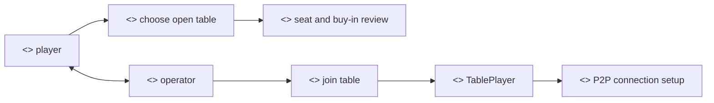
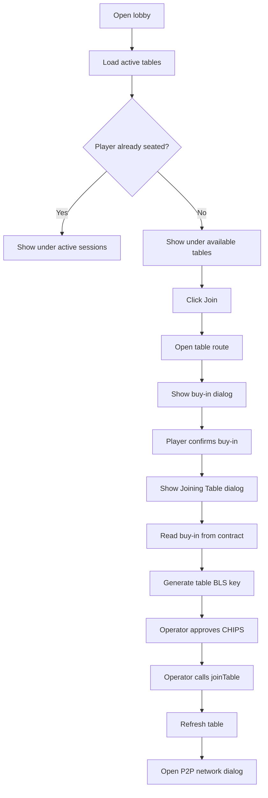

# Join Table Flow

## Purpose

The Join Table flow lets a subscribed player buy in to an existing open table, stores the player's announce key on-chain, and starts the P2P connection process once the player is seated.

## Actors

- Player: chooses an available table and confirms the buy-in.
- Player operator: approves CHIPS and submits `joinTable`.
- PrivatePoker lobby contract: validates the table and appends the player.
- Existing table peers: receive the new player through chain polling and P2P connection setup.

## Rationale

Joining a table is where a second or later player accepts the same economic and gameplay conditions as the creator. The goal is to show how the product prevents unverified or unsubscribed users from entering active games and how it presents buy-in commitment before wallet/operator actions.

This flow matters because it must make table state, buy-in amount, seat availability, and P2P readiness clear before the user commits chips. It also links on-chain table membership to the peer-to-peer networking layer, so mistakes here can affect both funds movement and gameplay continuity.

We provide the following user-facing operations:

- Choosing an open table from a lobby. Completed tables are excluded from the ordinary lobby list so the player is not offered stale games.
- Reviewing table buy-in and seat availability. This gives the player a clear commitment point before CHIPS are moved.
- Approving and submitting the buy-in. The operator performs the table join only after the visible dialog explains the steps.
- Storing the player's announce key on-chain. Existing peers use this to start the peer-to-peer connection process.
- Moving the table toward running state when the final required player joins.

## Methods

- Lobby route: [`/lobby/:id`](<../src/app/(site)/lobby/[id]/page.js>)
- Lobby screen: [`LobbyClient`](../src/components/lobby/LobbyClient.jsx)
- Table list: [`GameLobby`](../src/components/lobby/GameLobby.jsx)
- Table route: [`/tables/:id`](<../src/app/tables/[id]/page.js>)

## Prerequisites

- The player has a verified account and active subscription.
- The target table is not already full.
- The player has enough CHIPS for the table buy-in.
- The player has not already joined the same table.

## Procedure

1. The player opens a lobby.
2. The lobby loads active tables and separates already joined tables from joinable tables.
3. The player clicks `Join` on a non-full table.
4. The table route opens and reads table detail from the lobby contract.
5. The buy-in dialog shows the required CHIPS amount.
6. The player confirms the buy-in.
7. The app opens the join-table progress dialog.
8. The app reads the current buy-in from contract state.
9. The app derives the table BLS announce key.
10. The operator approves the lobby for the CHIPS buy-in if needed.
11. The operator calls `joinTable`.
12. The table refreshes and the P2P rejoin dialog opens.

## Expected Outcomes

- The player becomes seated at the table.
- The lobby eventually moves the table from open to running once all seats are filled.
- The player is prompted to join the P2P network before gameplay proceeds.
- The table appears in `Your Active Protocols` for the player while it is active.

## Waiting And Error States

- The table screen delays the buy-in dialog briefly so the table detail can settle.
- The buy-in dialog shows the required buy-in before any operator operation begins.
- The join flow dialog tracks BLS key generation, CHIPS approval, and `joinTable`.
- Operator gas shortage can trigger `TopUpOperatorGasDialog`.
- Chain or wallet errors are formatted and shown in the flow dialog.

## Stable State And Memoization

- `useLobby` refreshes from contract events and connection changes, but the lobby list split is memoized inside `GameLobby`.
- `TableClient` memoizes the player-address list before passing it to `useAccounts`, avoiding unnecessary profile lookups.
- `useTable` memoizes seats and the current seat so downstream P2P hooks do not see a new object graph on every render.

## Implementation Reference

- [`useLobby`](../src/hooks/useLobby.js) loads active tables and player table ids.
- [`GameLobby`](../src/components/lobby/GameLobby.jsx) renders Join, Watch, and Return actions.
- [`BuyInDialog`](../src/components/table_screen/dialogs/BuyInDialog.jsx) creates the join request.
- [`JoinTableFlowDialog`](../src/components/table_screen/dialogs/JoinTableFlowDialog.jsx) displays operation progress.
- [`useJoinTable`](../src/hooks/useJoinTable.js) reads current buy-in, generates keys, approves CHIPS, and calls `joinTable`.

## Audit Notes

- The `Join` link omits `lobbyId` in the table URL. The table page defaults `lobbyId` to `1`, so this is safe only for lobby `1`; multi-lobby UX should include `?lobbyId=${lobbyId}` consistently.
- `useJoinTable` correctly reads buy-in from contract state instead of trusting the lobby-row value.
