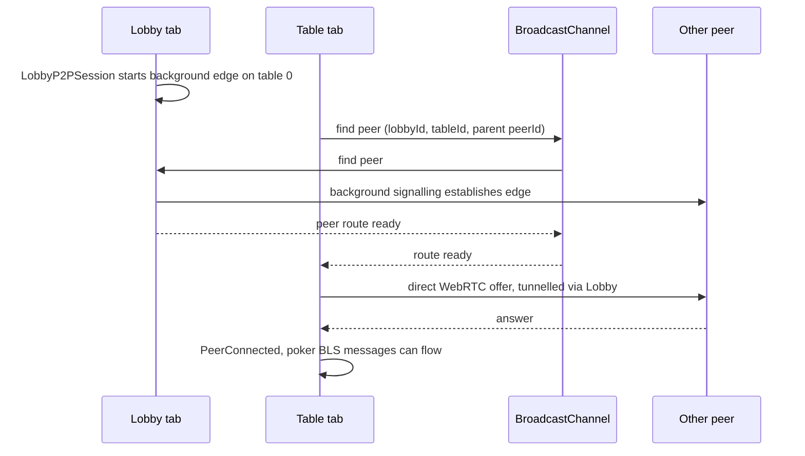

# Private Poker P2P Boundary

`private-poker-vite` owns no raw WebRTC signalling. The `privatepoker-p2p` package owns
connection establishment, mesh fallback, neural relay, and connection-state events.

## Tab ownership

- The **Lobby tab** owns every background P2P edge. `useLobbyP2PSession` constructs one
  `LobbyP2PSession`; that session owns the only neural routing node and answers table
  discovery requests over `BroadcastChannel`.
- A **Table tab** owns exactly one direct subscription. `PokerRtcSession` constructs a
  `TableP2PSession` with the parent Lobby's `peerId` (passed in the table URL). It asks
  the Lobby for peers and tunnels signalling through the Lobby's background edge until
  the direct edge is open.
- No tab uses browser storage. All P2P state is in memory and dies with the tab.

## App responsibilities

- `src/hooks/useTable.js` chooses the previous occupied seat in the token-ring topology.
- `src/hooks/useNetwork.js` prepares deterministic table BLS keys, supplies the parent
  `peerId`, and wires React callbacks.
- `src/lib/PokerRtcSession.js` adapts poker transport messages to
  `TableP2PSession.subscribe()`, `send()`, and `setLocalStream()`.
- `src/hooks/useLobbyP2PSession.js` connects the Lobby tab to its session and surfaces
  waiting-peer prompts. `WaitingPromptPolicy` lives in `src/lib/lobby/`.

Poker messages are BLS-signed in `PokerRtcSession` before being sent. Incoming poker
messages are verified against the announce public key stored on-chain before they reach
the table state machine.

## Library responsibilities

- `LobbyP2PSession` establishes background WebRTC edges on the Lobby's table `0`.
- `TableP2PSession` establishes the table's direct WebRTC edge.
- `BackgroundConnectionKeeper` keys background edges by peer address and answers
  table find-peer requests.
- `TableTunnelServer` relays table signalling through the Lobby's background edge.

## Runtime flow

