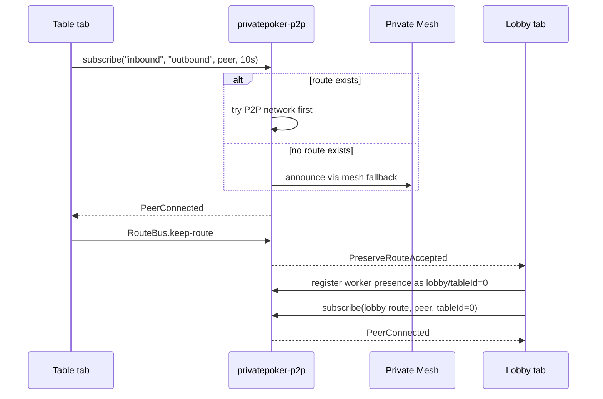

# Private Poker P2P Boundary

`private-poker-vite` no longer owns raw WebRTC signalling code. The app uses the standalone
`privatepoker-p2p` package for connection establishment, mesh fallback, P2P relay, route
preservation, and connection-state events.

## App Responsibilities

The Vite app owns poker-specific orchestration:

- `src/hooks/useTable.js` chooses the previous occupied seat in the token-ring topology.
- `src/hooks/useNetwork.js` prepares deterministic table BLS keys and wires React callbacks.
- `src/lib/PokerRtcSession.js` adapts poker transport messages to `VirtualNetwork.subscribe()`
  and `VirtualNetwork.send()`.
- `src/hooks/useLobbyRouteKeeper.js` starts the lobby background route keeper while the lobby
  tab is open.

Poker messages are BLS-signed in `PokerRtcSession` before they are sent. Incoming poker messages
are verified against the announce public key stored on-chain before they are passed into the
table state machine.

## Library Responsibilities

The `privatepoker-p2p` package owns P2P mechanics:

- `VirtualNetwork.subscribe(subscriptionLabel, channelLabel, peerAddress, timeout, lobbyId, tableId)`
  establishes a WebRTC data channel.
- `VirtualNetwork.send(channelLabel, message)` sends application data over the established channel.
- `LobbyRouteKeeper` maintains lobby-level background P2P routes with `tableId=0`.
- `RouteStore` records active background routes so new table tabs can try P2P first.
- `RouteBus` carries local route-preservation requests between table tabs and the lobby tab.
- The library control worker registers lobby presence immediately as `role=lobby`, `tableId=0`,
  so control messages have a concrete lobby endpoint to route to before any visible table
  subscription is active.

## Runtime Flow

On later table rejoins, `PokerRtcSession` asks `RouteStore` whether the lobby has a background
route to the peer. If yes, `VirtualNetwork` starts with P2P signalling instead of mesh.
