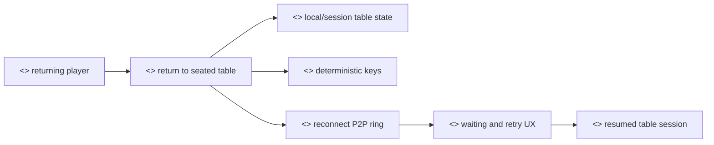
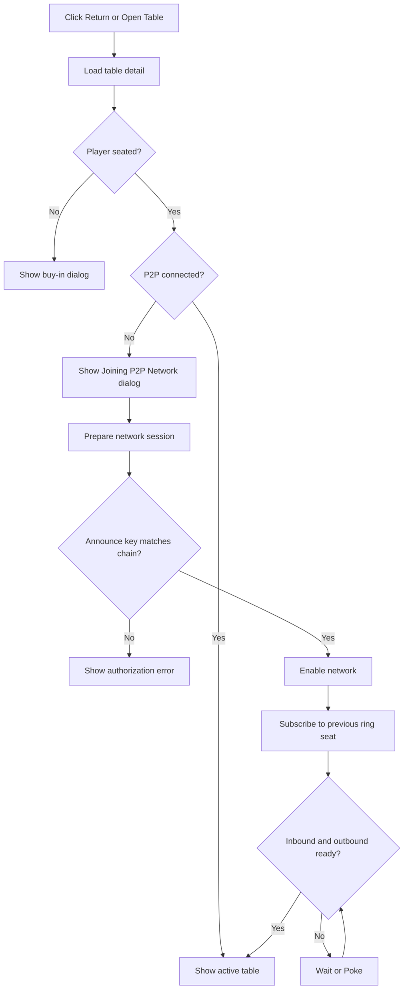

# Return To Table Flow

## Purpose

The Return To Table flow restores a seated player's table session, prepares deterministic keys, reconnects the token-ring P2P channel, and resumes hand synchronization.

## Actors

- Returning player: reopens a table where their wallet is already seated.
- Previous ring peer: receives the returning player's subscription or poke.
- Next ring peer: subscribes to the returning player through the token-ring topology.
- Local RTC pool and Private Mesh: route connection bootstrap signals.

## Rationale

Peer-to-peer gameplay depends on players being able to recover state after refreshes, disconnects, or wallet reconnection. The goal is to show that the prototype treats reconnection and continuity as consumer-protection issues, not just technical convenience.

This flow matters because a player may still have chips committed to a table even when their browser session is gone. A clear return path reduces confusion, lowers dispute risk, and makes the system more resilient without depending on a central game server. It also creates a focused discussion point for interrupted sessions, peer availability, timeout policy, and user messaging when gameplay cannot resume cleanly.

We provide the following user-facing operations:

- Listing tables where the player is already seated. This gives a returning player a route back to committed chips and active gameplay.
- Restoring table session material. Deterministic keys and stored session snapshots reduce the chance that a refresh loses table context.
- Reconnecting to ring peers. The app uses Private Mesh and RTC signalling to rejoin the peer-to-peer topology.
- Showing waiting or reconnection states. This prevents the player from confusing a network wait with a lost balance or failed table.

## Methods

- Lobby active-session list: [`GameLobby`](../src/components/lobby/GameLobby.jsx)
- Connection request dialog in lobby: [`GameLobby`](../src/components/lobby/GameLobby.jsx)
- Table route: [`TableClient`](../src/components/table/TableClient.jsx)

## Prerequisites

- The account session exists in local app state or can be restored by signing in.
- The player is present in `getPlayerTables(playerAddress)`.
- The table remains active in the lobby contract.
- The stored announce public key matches the deterministic table key generated by the current session.

## Procedure

1. The player clicks `Return` from `Your Active Protocols`, or opens the table from a peer waiting dialog.
2. The table route loads table detail and player seating status.
3. If the player is seated and P2P is not connected, the rejoin dialog opens.
4. The app prepares the network session and verifies that the generated announce key matches the on-chain key.
5. The app enables the network.
6. The player subscribes to the previous occupied seat in the ring.
7. The app waits for inbound and outbound channels.
8. If no inbound subscriber appears after the search window, the dialog exposes `Poke`.
9. When inbound and outbound are ready, the dialog closes and the table is usable.
10. If a reconnect happened after gameplay started, history synchronization can send a sync message to bring peers back to the current hand tip.

## Expected Outcomes

- A seated player reconnects to the same table without another buy-in.
- The P2P dialog remains visible until the connection is usable.
- A peer waiting in the lobby can prompt the player to open the required table tab.

## Waiting And Error States

- The table route renders an empty loading body while contract data loads.
- The rejoin dialog shows separate Security, Peer Connection, and Subscription states.
- The Peer Connection step can show Searching, Connecting, connected, or a Poke action.
- A table key mismatch is a hard authorization error and instructs the player to rejoin so chain state matches deterministic keys.
- If media data channels are required, `MediaDataChannelDialog` explains the browser requirement.

## Stable State And Memoization

- `useTable` memoizes `tableSessionDetails`, `seats`, `mySeatNo`, `previousSeat`, and the returned table object.
- `useNetwork` memoizes the BLS action key and player list, then updates a persistent `PokerRtcSession` instance rather than recreating it.
- `TableClient` memoizes `displayTable`, `debugMessages`, `consoleIdentity`, `terminalResult`, and `webcamView`.
- `usePokerTable` uses refs and memoized action/state objects to prevent repeated protocol actions when React re-renders.

## Implementation Reference

- [`TableClient`](../src/components/table/TableClient.jsx) decides when to show buy-in, join, rejoin, media, and terminal dialogs.
- [`useTable`](../src/hooks/useTable.js) polls chain state, builds seats, and connects table state to the token ring.
- [`ReJoinTableFlowDialog`](../src/components/table_screen/dialogs/ReJoinTableFlowDialog.jsx) prepares security and waits for P2P readiness.
- [`useNetwork`](../src/hooks/useNetwork.js) owns `PokerRtcSession` and network session preparation.
- [`p2p.md`](./p2p.md) documents lower-level RTC bootstrap details.

## Audit Notes

- The reconnection lock in `usePokerTable` intentionally avoids repeated setup on every render after a connection is established. This should be preserved when editing connection effects.
- The waiting-peer lobby dialog helps repair the case where a remote peer can reach the lobby tab but the specific table tab is closed.
