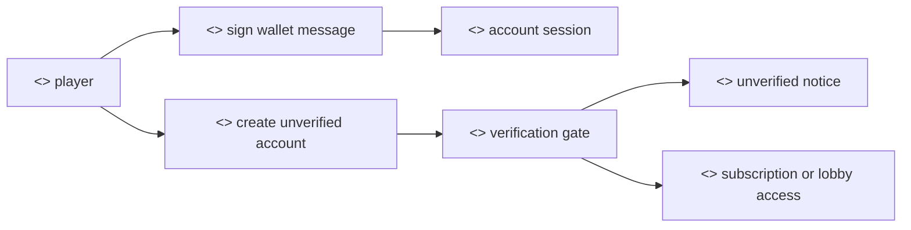
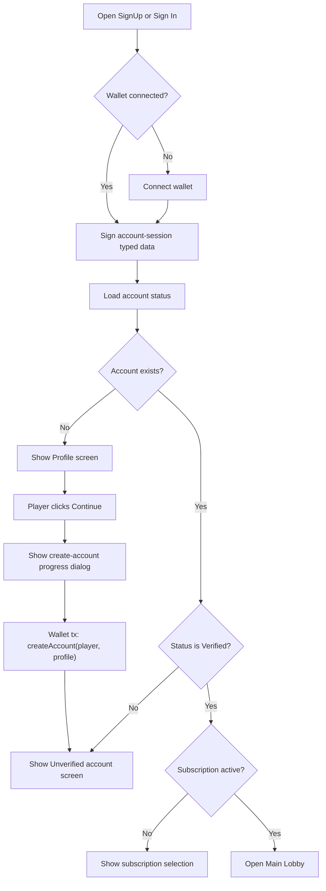

# SignUp Flow

## Purpose

The SignUp flow creates or restores a player account session, collects the public profile fields used by the Vite app, creates an unverified on-chain account when needed, and routes the player toward verification, subscription, or the main lobby.

## Actors

- Player: signs the account-session message and submits any wallet transactions.
- Player wallet: provides the wallet address and signs typed data or transactions.
- Player operator: derived from the session seed; later performs subscription and table operations.
- PrivatePoker account contract: stores account status, profile blob, operator, announce key, and subscription state.

## Rationale

SignUp is the control point where a casual visitor becomes a known protocol participant. The goal is to demonstrate that access to value-bearing gameplay is intentionally gated. For an Innovation Hub discussion, this is where regulatory feedback can shape onboarding before launch: KYC, eligibility, sanctions screening, jurisdiction checks, account suspension, consumer disclosures, and responsible-gaming controls can all be connected to the account status model before a player reaches subscription or the main lobby.

The reason the account is first created as `Unverified` is to separate identity/session creation from permission to play. That gives the project a clear place to pause the user journey, request verification, and prevent subscription or table access until the account has been reviewed.

We provide the following user-facing operations:

- Creating or restoring a wallet-backed account session. This proves wallet control without moving funds.
- Collecting a minimal public profile. This gives the table and lobby UX a display identity without treating profile completion as KYC.
- Creating an unverified on-chain account. This records the player while keeping gameplay access locked.
- Showing verification, subscription, or main-lobby screens based on account status and subscription expiry.

## Methods

- Route: [`/signin`](<../src/app/(site)/signin/page.js>)
- Screen: [`AccountSignin`](../src/components/account_signin/Component.jsx)
- State and contract operations: [`useAccounts`](../src/hooks/useAccounts.js)

## Prerequisites

- The player can connect a wallet through the configured wallet provider.
- `PRIVATE_POKER_CONTRACT_ADDRESS` is configured for account reads and writes.
- `PPDC_CONTRACT_ADDRESS` is configured before subscription can proceed.
- A player must have account status `Verified` before subscription selection or main-lobby access is shown.

## Procedure

1. The player opens the SignUp or Sign In screen.
2. The player connects the wallet if it is not already connected.
3. The wallet signs the Private Poker account-session typed data. This creates a local account session and deterministic operator material.
4. The app reads account status with `getAccountStatus(playerAddress)`.
5. If the account does not exist, the profile screen is shown.
6. The player completes the profile and clicks Continue.
7. The app opens a progress dialog before the wallet transaction prompt.
8. The player wallet calls `createAccount(playerAddress, displayName, encryptedProfile)`.
9. After the transaction confirms, the app shows the account as unverified and asks the player to email `imperfect-protocol@protonmail.com`.
10. If the account is already verified, the app continues to subscription selection when the subscription is expired, or to the main lobby when the subscription is active.

## Expected Outcomes

- A new player leaves the flow with an unverified on-chain account and clear verification instructions.
- A verified player with an active subscription reaches `/main-lobby`.
- A verified player with an expired or missing subscription reaches subscription selection.
- Suspended, banned, or deleted accounts do not see subscription selection or the main lobby.

## Waiting And Error States

- Account reads show an empty loading body while `isCheckingAccount` is true.
- Profile creation uses an operation dialog with yellow active, green complete, and red error step states.
- Signature cancellation sets a visible sign-in error.
- Contract write failures are formatted through `formatChainError` and leave the player on the current step.
- Unverified, suspended, banned, and deleted states are presented by `AccountStatusPanel`.

## Stable State And Memoization

- `useAccounts` memoizes the typed-data payload and display fields so the sign-in message does not churn between renders.
- Player display-name lookups are keyed through a sorted `playerAddressesKey`, reducing repeated account reads when equivalent address lists are recreated.
- The operation dialog state is explicit and step-oriented, which keeps wallet and operator operations visible without tying UI progress to incidental renders.

## Implementation Reference

- [`AccountSignin`](../src/components/account_signin/Component.jsx) renders the four visible stages: Signature, Profile, Verification, and Subscription.
- [`useAccounts`](../src/hooks/useAccounts.js) owns account loading, profile blob creation, `createAccount`, subscription payment, and navigation.
- [`FlowStepDialog`](../src/components/table_screen/dialogs/FlowStepDialog.jsx) provides the shared operation-progress UI.

## Audit Notes

- The business requirement names the first button `SignUp`, while the current Vite screen labels the action as `Connect Wallet` or `Sign In`. The route and flow match the requested business case, but the CTA text may need product copy alignment.
- The account-creation dialog appears before the wallet transaction prompt, which satisfies the current wallet-prompt sequencing requirement.
