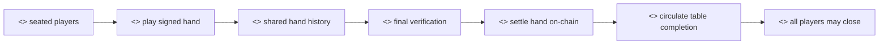
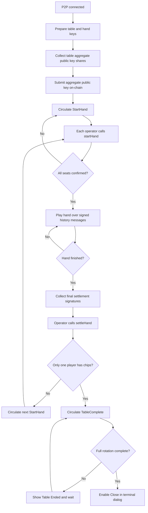

# Table-Hand Gameplay Start To End Flow

## Purpose

The Table-Hand Gameplay flow coordinates P2P poker actions, verifies hand history, submits on-chain hand-start and final-settlement operations, and presents the correct terminal result when the table is complete.

## Actors

- Seated players: each owns a local copy of poker state and participates in the token-ring action flow.
- Player operators: submit on-chain `setTableAggregatePublicKey`, `startHand`, and `settleHand` operations.
- Token-ring network: circulates gameplay, settlement, and table-completion messages.
- PrivatePoker contracts: store hand state, table aggregate public key, and settlement results.
- Crumble poker engine: applies and verifies local poker actions.

## Rationale

The hand lifecycle is the core trust question. The goal is to show how the project separates fast peer-to-peer gameplay from auditable settlement and how it handles the terminal state of a table.

Players need confidence that the hand was played fairly, that final state was agreed by the peers, and that on-chain settlement reflects the verified result. The table-completion circulation matters because every seated player must see the terminal state before the UX allows closure; otherwise one client can appear finished while others are still waiting, which is poor conduct design and weakens dispute evidence.

We provide the following user-facing operations:

- Establishing the table cryptographic identity. Players contribute to the aggregate key used for verification.
- Starting a hand only after all seats are ready. This gives every player a shared on-chain checkpoint.
- Circulating gameplay actions through the peer-to-peer ring. Each player can validate the same signed history.
- Collecting final verification and submitting settlement. This turns the agreed hand result into on-chain table balances.
- Circulating table completion before enabling Close. This ensures every player sees terminal state before leaving the table.

## Methods

- Active table route: [`TableClient`](../src/components/table/TableClient.jsx)
- Gameplay hook: [`usePokerTable`](../src/hooks/usePokerTable.js)
- Verification hook: [`useFinalVerification`](../src/hooks/useFinalVerification.js)
- Protocol state model: [`table_protocol_state`](../src/lib/table_protocol_state.js)

## Prerequisites

- The table is full enough to start gameplay.
- Every seated player has an announce public key stored on-chain.
- P2P inbound and outbound channels are connected.
- The current player can derive table and hand BLS keys from the account session.

## Procedure

1. Once P2P is connected, the app prepares keys and initializes local poker state.
2. Seat `0` begins table setup by circulating table aggregate public key shares.
3. When all shares are collected, an operator submits the aggregate public key on-chain.
4. A `StartHand` protocol message circulates.
5. Each player calls `startHand` on-chain through their operator.
6. Once every seat has confirmed the hand start, local hand state moves to in-progress.
7. Poker actions circulate through signed history messages.
8. Non-acting players submit no-op messages to keep the ring moving.
9. Human betting states show the action bar only for the current player.
10. At hand finish, the table moves into final settlement.
11. Players circulate final verification signature shares.
12. When final verification is complete, an operator submits `settleHand` on-chain.
13. If more than one player has chips, the next hand is started.
14. If all but one player have been eliminated, a `TableComplete` message circulates through every seat before the terminal dialog can close.

## Expected Outcomes

- Every peer applies the same signed hand history in the same order.
- Final settlement is submitted once enough signature shares are collected.
- Normal hand completion shows winner and payout state.
- Table completion shows the `Table Ended` terminal dialog for every player.
- The Close button remains disabled until the table-completion message has completed a full circulation.

## Waiting And Error States

- The action bar is hidden unless the local seat is allowed to act.
- Protocol automation is gated by `protocolActionInFlightRef` and protocol-state checks.
- Missing aggregate public key shares, missing operator keys, or on-chain submission failures become game log errors.
- Invalid signed hand history entries are rejected and logged.
- Cheating reports can produce a terminal cheated result instead of normal settlement.
- During table completion, `TerminalResultDialog` displays `Waiting for other players` until circulation is complete.

## Stable State And Memoization

- `TableClient` uses `lastProtocolActionKeyRef` to avoid resubmitting automatic protocol actions when React rerenders with equivalent state.
- `usePokerTable` memoizes `actionBarProps`, `pokerTableState`, and `pokerTableActions`.
- `usePokerTable` keeps protocol-critical mutable values in refs: current game, history, seen history tips, in-flight protocol action, final verification, and connection initialization.
- The connection effect uses an initialization ref so a stable connected state does not repeatedly restart table setup.
- `TableScreen` memoizes parsed community cards, which prevents needless card parsing during unrelated state updates.

## Implementation Reference

- [`usePokerTable`](../src/hooks/usePokerTable.js) owns local poker state, protocol transitions, message handling, settlement, and table completion.
- [`useFinalVerification`](../src/hooks/useFinalVerification.js) builds settlement calldata, appends raw signatures, and submits on-chain calls.
- [`TableProtocolState`](../src/lib/table_protocol_state.js) names the protocol states: aggregate key, start hand, hand in progress, settle hand, table complete, and disputed.
- [`TerminalResultDialog`](../src/components/table_screen/dialogs/TerminalResultDialog.jsx) gates the table-completion close action.
- [`TableScreen`](../src/components/table_screen/Component.jsx) renders table state, action bar, community cards, payout animation, and terminal overlays.

## Audit Notes

- Current UX implements table-completion circulation: the first completing player publishes `TableComplete`, every targeted player forwards it, and the origin seat marks completion after all seats have been visited.
- The initial publisher does not immediately show a terminal dialog unless the table has one or fewer seats; the origin player sees the dialog when the circulated message returns. This matches the close-gating requirement but may feel delayed if the first player expects an immediate table-ended modal.
- The `StartHand` path requires every player to submit an on-chain confirmation before local gameplay begins. This is stricter than a single coordinator start and should remain visible in any future UX status copy.
